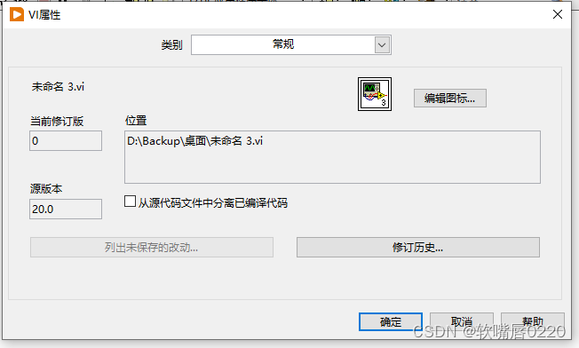
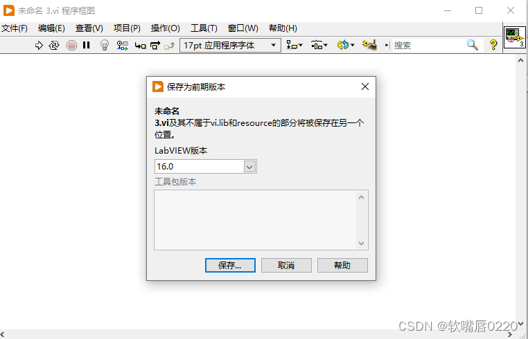

开发机上装的是 LabVIEW 2025（25.0），现场那台是 LabVIEW 2019（19.0），程序得跟着过去。这件事不能靠拷贝：LabVIEW 的版本兼容是单向的，高版本能直接打开低版本，低版本打不开高版本，硬开会报错。要往下走，只能在高版本里先另存一份前期版本。下面按 25.0 到 19.0 这个场景，把原文的步骤重排一遍，顺带说清降版本会丢掉什么。

## 先确认程序是哪个版本写的

打开 VI，文件 → VI 属性（Ctrl+I），类别停在「常规」，左下角「源版本」这一栏就是这份 VI 当初保存时的版本号。下图里是 20.0，说明它是 LabVIEW 2020 写的。同一页的「当前修订版」是修订计数，跟版本号不是一回事，别混。

## 另存为前期版本

菜单 文件 → 保存为前期版本，在弹出的对话框里选 LabVIEW 版本。版本号和年份的对应很简单：2016 是 16.0，2019 是 19.0，2020 是 20.0，2025 是 25.0，年份后面补个零头就行。选 19.0，点「保存」，再挑一个目录，LabVIEW 会在那里另存一份，原文件不动。对话框上也写明了：VI 里不属于 vi.lib 和 resource 的部分会被存到另一个位置。

不用一级一级往下倒，从 25.0 直接选 19.0 就可以。NI 知识库的说法是这条路最远能回到 LabVIEW 8.0，比 8.0 更早的才需要拿几个 LabVIEW 接力转。

## 降完先去 19.0 里编译一遍

保存完会弹「保存为前期版本警告摘要」，别习惯性点忽略。19.0 里没有的函数、结构、属性，转过去要么变成带问号的 VI，要么整段丢掉，块图上就是断线。工具包里的 VI 也不跟着转，NI 的解释是工具包各有自己的版本；vi.lib 和 resource 里的 VI 不重复存，打开时自动链接到 19.0 自己的库。

所以顺序是：先在 25.0 里把程序跑通，再降版本，然后在 19.0 里打开、编译，按警告摘要逐条核对。这一步省掉，等于把问题留到现场。

> 来源：CSDN 博主「软嘴唇0220」《代码在不同版本Labview中如何使用，以及常用资源包的兼容性》，https://blog.csdn.net/m0_51259350/article/details/133947063 ，CC 4.0 BY-SA。原文以 LabVIEW 2016 为例，本文按 25.0 到 19.0 重写步骤；图片已转存到本站，原文链接失效也不影响阅读。版本回退的上下限与警告行为另据 NI 知识库《Saving LabVIEW Files to a Previous Version》核对。

一句话：LabVIEW 只往上开、不往下开，往下走靠「保存为前期版本」，降完必须在目标版本里重新编译验收。

  <button type="button" class="wxshare-btn" id="wxshare-btn" aria-label="发到微信">
    <svg viewBox="0 0 24 24" aria-hidden="true"><path d="M9.4 4C5.4 4 2.2 6.6 2.2 9.8c0 1.8 1 3.4 2.7 4.5l-.7 2.1 2.4-1.2c.8.2 1.7.4 2.6.4h.5c-.2-.5-.3-1-.3-1.5 0-3 3-5.4 6.7-5.4h.6C16.1 6 13.1 4 9.4 4Zm-2.6 3.4a.95.95 0 1 1 0 1.9.95.95 0 0 1 0-1.9Zm5.2 0a.95.95 0 1 1 0 1.9.95.95 0 0 1 0-1.9Z"/><path d="M21.8 13.9c0-2.6-2.6-4.7-5.8-4.7s-5.8 2.1-5.8 4.7 2.6 4.7 5.8 4.7c.7 0 1.4-.1 2-.3l2 1-.6-1.7c1.5-.9 2.4-2.2 2.4-3.7Zm-7.7-1.5a.8.8 0 1 1 0 1.6.8.8 0 0 1 0-1.6Zm3.8 0a.8.8 0 1 1 0 1.6.8.8 0 0 1 0-1.6Z"/></svg>
    发到微信
  </button>
  

