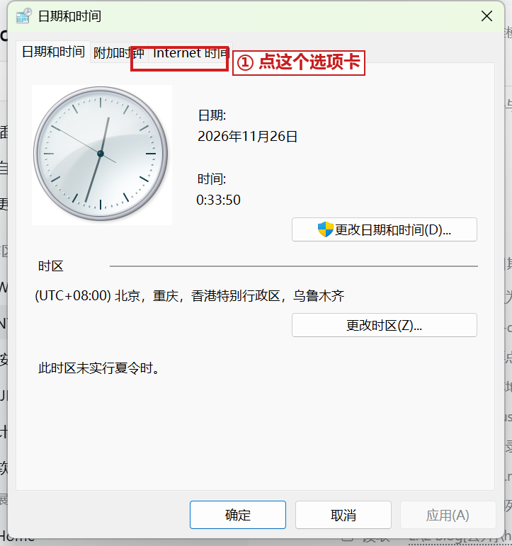
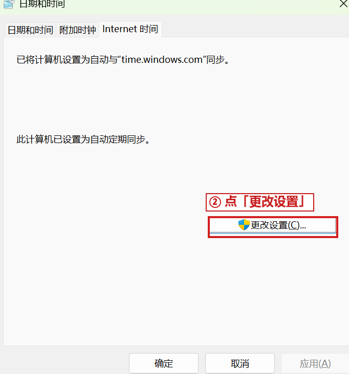

实验室里经常碰到这种事：三台电脑并排放着，屏幕上时间差了两三分钟；拿手机一对，又都不对。更麻烦的是采集数据打时间戳，两台机器的时间对不齐，事后根本没法对齐分析。

问题不在电脑本身。每台电脑都有自己的晶振，各自走各自的，一天差几秒很正常，一个月下来就能差出几分钟。要解决，得给它们找一个共同的、准的时间源，让所有机器都往这一个源上靠。

## 授时是怎么做的：卫星到天线，网线到电脑

NTP 服务器自己并不产生时间，它有一条取时的路，一条发时的路。

取时靠卫星。楼顶或窗外装一个蘑菇头天线，收北斗或 GPS 发来的信号，这根信号走同轴电缆进机房，插到服务器背面的天线口。卫星信号里带着标准时间，设备解出来，自己就成了一个一级时间源。

发时靠网口。服务器把时间通过 NTP 协议从网口发出去，经过交换机，到每一台电脑。电脑收到之后，不是直接把时间抄过来，而是算一个偏差，再慢慢把自己的钟调过去。

这个算法叫 NTP，核心是四个时间戳。电脑发请求时记下 t1，服务器收到记 t2、回发记 t3，电脑收到记 t4。用这四个数能算出两件事：一来一回花了多久（网络延迟），以及两边差了多少（时钟偏差）。把延迟减掉，剩下的就是真实偏差。单次测量会被网络抖动带偏，所以实际是连续采好几次，挑最可信的用。

修正也分轻重。差得少，就让本地钟走快一点或慢一点，慢慢追上，避免时间突然倒退把日志、数据库搞乱；差得多，才直接跳过去。

服务器自己是分层的。直接接卫星的叫一级，从一级那里取时间的叫二级，往下类推。电脑优先找层级低、离得近的源。

## 实验室里为什么会各走各的

回到现场。几台电脑时间不一致，常见就三个原因。

一是各台机器各自跟公网对时。有的连得上 time.windows.com，有的连不上，有的根本没开自动同步。内网不通外网的时候，Windows 会一直报同步失败，时间就靠本地晶振自由跑。

二是晶振本身会漂。普通主板上的晶振，一天差几秒是常态，机器常年不关也照样漂。

三是有的机器压根没开 Windows 时间服务。服务被禁用或者设成手动，界面点了没反应，报 0x80070426。

三种情况指向同一个解法：在实验室内部放一台准的源，所有电脑都指向它，不让它们各自去公网碰运气。这台源就是接北斗的授时服务器。

## 一台授时服务器怎么接

需要的线就三根：天线、网线、电源。

天线接设备背面的天线口，收北斗和 GPS 双模信号，室内机房接一根同轴电缆进来就行，天线本体在楼顶或窗外。网线接交换机的任意口，负责把时间发给下游。电源接 220V。

设备面板上有两个灯值得看。SAT 灯是卫星状态，熄灭表示收到三颗以上、位置有效；连续闪三下表示一颗都没收到，这时候设备会切到内部晶振顶时间；闪两下表示正在修正。网络口的绿灯只说明「已与时间源同步、能对外服务」，它不能证明时间源是卫星，因为晶振顶上时它也可能亮，这个区别要记住。

LCD 屏上能直接读到卫星颗数和用的是北斗还是 GPS。再往里，登录后台看日志最准。

## 电脑上怎么设

先分清两个地址。一个是你电脑自己的 IP，在网络适配器属性里改，决定它在哪个网段、能不能跟服务器通上话；另一个是时间服务器地址，在日期和时间设置里改，告诉 Windows 该去问谁要时间。很多人第一次配会把这两个填反。

三个系统用的是同一个「日期和时间」对话框，入口路径和窗口边框风格不同。Win11 和 Win10 是控制面板 → 时钟和区域 → 日期和时间；Win7 是控制面板 → 时钟、语言和区域 → 日期和时间。下面以 Win11 界面为例。

打开后，点最右边那个「Internet 时间」选项卡。



切过去会看到一行提示，告诉你当前在跟哪台服务器同步。下面那个带盾牌图标的「更改设置」，才是能改的地方。



点开之后，勾选「与 Internet 时间服务器同步」，在服务器框里键入内网服务器的 IP，点「立即更新」，等它提示成功，再点确定。

有个容易踩的点：点「确定」只是把地址写进注册表，点「立即更新」才会当场去连一次。连不上会报「同步时出错」，地址通常留不住。所以填完必须点一下立即更新。

加入域的电脑，这个选项卡会直接消失，时间由域控统一管，不用在这里改。

界面点不动或者要批量设，管理员 cmd 里三行：

```
w32tm /config /manualpeerlist:"192.168.1.20" /syncfromflags:manual /update
net stop w32time && net start w32time
w32tm /resync
```

看偏差用 `w32tm /stripchart /computer:192.168.1.20 /samples:5`，它连采几次样，把每次的偏差打出来，稳定在几十毫秒内就说明通了。

虚拟机的集成服务如果带着「时间同步」，会和 w32time 抢，两个源来回拉，时间反而跳，先把它关掉。

## 怎么确认它真的在授时

授时服务器是不是真的锁上了卫星、是不是真的在给电脑发时间，三个地方能查。

面板上的 SAT 灯和 LCD 是最快的，前面说过。要更确凿，登录后台，用浏览器输设备 IP 试 Web 界面，不行就 telnet：

```
telnet 192.168.1.20 9999
```

Win10、Win11 默认没装 telnet 客户端，先去「启用或关闭 Windows 功能」里勾上。后台里能看四个网口的 IP、卫星状态、最近几十条授时日志。如果 IP 忘了或者网络不通，接背面 RS232 口走串口也能进，9600、奇校验、8 位、1 停止位。

至于「它给了谁时间、给了几次」，设备本身记不了那么细，只有最近几十条日志。要看每台电脑的实际偏差，在客户端这边用 stripchart 量，或者用厂家配套的监视软件集中采。

## IP、掩码、DHCP：为什么改网段就通了

最后一个问题：为什么把电脑 IP 改成 192.168.1 开头，就能连上那台服务器。

IP 分四段，像 192.168.1.100。子网掩码 255.255.255.0 的作用，是告诉设备前三段算院子名、最后一段算门牌号。于是 192.168.1 就是院子，100 是门牌。同一个院子里的设备，交换机直接转发；跨院子就得走网关。

所以电脑和服务器必须在同一个院子，或者中间有路由能过去。改网段的意思，就是把电脑挪进服务器所在的院子。掩码填错，院子划错了，地址看着像，照样不通。

IP 怎么来的，有静态和动态两种。动态是 DHCP 服务器自动发，设备一连上就喊「给我个地址」，路由器或专门的 DHCP 服务从池子里挑一个，连同掩码、网关一起递过去，有租期，到期要续。静态是手工写死，地址不变。服务器、打印机、时间服务器这类设备用静态，因为地址一改，所有客户端都得跟着改；办公电脑用动态，省事。

要不要装什么工具？不用。设置时间、测偏差、看配置，Windows 自带的 w32tm 和 ipconfig 就够。唯一要额外打开的是 telnet 客户端，那也只是系统里的一个可选功能。前提是电脑有一块能用的网卡，台式机主板自带网口，笔记本没网口就用 USB 转网口。

## 回到开头那个问题

几台电脑时间对不上，最省事的做法不是一台一台去公网碰运气，而是在实验室里放一台接北斗的授时服务器，把电脑都指到它身上。卫星给天线，天线给设备，设备通过网络给电脑，这条链上任何一环断了，时间就偏，而且通常不报错。

判断有没有真对上星，看 SAT 灯和 LCD，别只看网络口的绿灯；判断电脑有没有真同步上，用 stripchart 量偏差，别只看界面打了勾。

