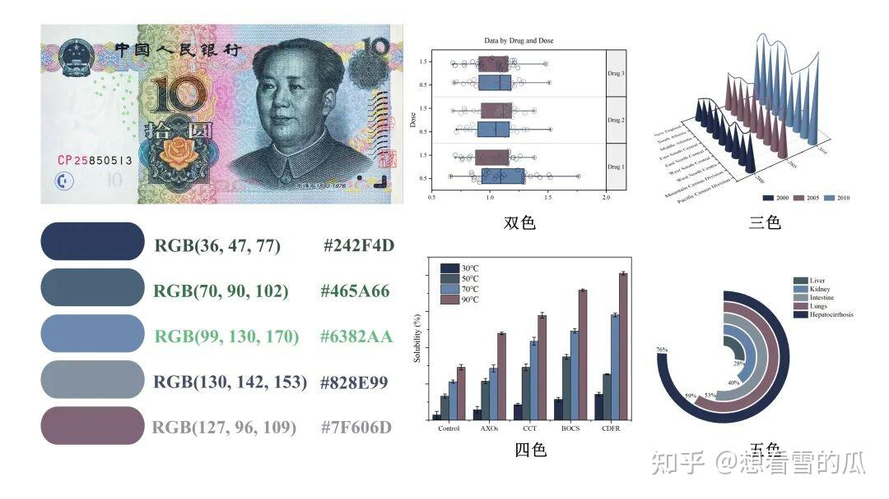

---
title: "用人民币配色画图，竟然是顶刊配色！（附红绿色弱下的选色计算）"
date: 2026-11-23T22:50:00+08:00
lastmod: 2026-11-23T22:50:00+08:00
description: '人民币六个面额就是六套五级色卡；再用二色视模拟算一遍，红绿色弱下该选哪一套、取哪几级。'
tags: ["科研绘图", "配色", "Origin", "转载"]
categories: ["技术"]
draft: false
---

科研绘图不只是把数据画出来，而是用视觉去表达数据。在一篇论文当中，如果配色稳定、有层次，即使图很简单，也会显得很专业，而且还会吸引到审稿专家的注意。

有很多人不知道怎么去找配色，其实最受欢迎的配色就在我们身边——人民币配色。这个已经被验证过的成熟配色体系，用到 SCI 图形中，也有很好的效果。

> 前半部分的文字与六张色卡图转载自知乎专栏《用人民币配色画图，竟然是顶刊配色！》，作者「想看雪的瓜」，原文见文末，版权归原作者。色值表与后半部分（红绿色弱下的选色计算）是本文补的，图片未改。

## 六个色系

每个面额对应一套五级色卡，配了「双色／三色／四色／五色」四组示例。100 元红、50 元绿、20 元棕、10 元蓝、5 元紫、1 元浅绿，六套如下。

### 100 元（红色系）

### 50 元（绿色系）

### 20 元（棕色系）

### 10 元（蓝色系）

### 5 元（紫色系）

### 1 元（浅绿色系）

## 用法：一张图只用一个色系

素材里每张色卡都配了双色、三色、四色、五色四组示例，指向的其实是同一条规矩：**一张图在同一色系里取 2～5 级明度**，而不是在不同色相里各抓一个颜色。系列数少就取两端，系列数多就取中间，颜色顺序与系列顺序（小到大、对照组到处理组）保持一致。

按配图逐级抄录的色值（由深到浅），可直接填进 Origin 或 matplotlib：

| 面额 | 1（最深） | 2 | 3 | 4 | 5（最浅） |
|---|---|---|---|---|---|
| 100 元 红 | `#780018` | `#AA0033` | `#DD0022` | `#CC0044` | `#FA8095` |
| 50 元 绿 | `#25362B` | `#276E3D` | `#56B76A` | `#3C4061` | `#8E8E99` |
| 20 元 棕 | `#532F1A` | `#6B4E25` | `#7F5643` | `#796A5D` | `#BE9A62` |
| 10 元 蓝 | `#242F4D` | `#465A66` | `#6382AA` | `#828E99` | `#7F606D` |
| 5 元 紫 | `#413A4C` | `#63576F` | `#6C6E83` | `#6F8DB1` | `#B3A479` |
| 1 元 浅绿 | `#3C3F27` | `#5A5745` | `#9DA780` | `#937539` | `#C5AB71` |

取级建议：2 个系列取第 1、5 级；3 个取 1、3、5；4 个取 1、2、3、5；5 个全取。柱子配黑色描边，黑白打印也能分清。

> 一处原始标注有误：5 元紫第 3 级，图上写的十六进制是 `#56B76A`（那是 50 元绿的值），与同一行的 RGB(108,110,131) 冲突，上表按 RGB 值改正为 `#6C6E83`。

## 红绿色弱的理论计算

色卡好看不等于色盲也分得清。红绿色弱（绿色盲／红色盲）丢的是红—绿这条轴，六套色卡里哪些还能用，可以算出来：

1. 把每个色值转到线性 RGB，用 Viénot 1999 的二色视矩阵模拟绿色盲看到的颜色；
2. 再转 CIE Lab，两两求 ΔE76；
3. 判据取 ΔE>10 才算「明显可分」，ΔE<5 基本就是同一块颜色。

先按原文的四色取法（第 1、2、3、5 级）算每套的最小 ΔE：

| 色系 | 四色最小 ΔE | 说明 |
|---|---|---|
| 50 元 绿 | 23.8 | 数值最高，但靠的是亮绿与深藏青的明度跳变，不是「绿色安全」 |
| 10 元 蓝 | 12.7 | 明度跨度够，色相又落在保留的蓝—黄轴上 |
| 100 元 红 | 12.6 | 只能靠明度，且不要与绿、棕同图 |
| 1 元 浅绿 | 11.5 | 与 50 元绿会混 |
| 20 元 棕 | 10.3 | 与红色在色盲下几乎分不出 |
| 5 元 紫 | 7.7 | 第 2、3 级最接近，最差 |

再在每套里挑最抗色盲的四级，能明显抬高下限：

| 色系 | 最优四级 | 最小 ΔE |
|---|---|---|
| 50 元 绿 | 2、3、4、5 | 27.2 |
| 100 元 红 | 1、3、4、5 | 20.9 |
| 10 元 蓝 | 1、2、3、4 | 19.9 |
| 1 元 浅绿 | 1、3、4、5 | 15.9 |
| 5 元 紫 | 1、3、4、5 | 15.8 |
| 20 元 棕 | 1、2、4、5 | 13.6 |

还有一条不能破的规矩：**别跨色系混用**。模拟后红色与棕色 ΔE 只有 4.4、蓝色与紫色 2.7、绿色与浅绿 7.1，色盲眼里基本糊成一片；红色与绿色也不要放进同一张图。

## 结论：默认用 10 元蓝

1. 首选 10 元蓝，四系列取第 1、2、3、4 级：`#242F4D` `#465A66` `#6382AA` `#828E99`，最小 ΔE 19.9。
2. 理由不是它数值最高，而是它的区分**同时**有明度和色相两条腿——红绿色弱保留了蓝—黄轴，蓝色在该轴上是真的蓝，不靠明度硬撑；50 元绿虽然数值更高，一旦同图出现红或棕就立刻塌。
3. 20 元棕与 5 元紫不建议用于需要照顾色弱读者的图；实在要用，棕取 1、2、4、5 级，紫取 1、3、4、5 级。
4. 再加一道保险：柱子用 0.5～0.6 pt 黑描边，或给系列加斜线、点状填充，把辨识从「靠颜色」挪到「靠明度＋纹理」。

> 原文地址：https://zhuanlan.zhihu.com/p/2023895130940155098

同一份报告里，色系一旦定了就别中途换，读者是靠同一套明度顺序在认图。
