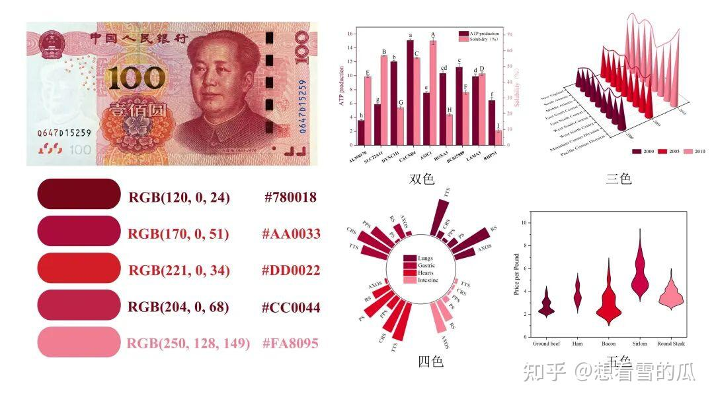
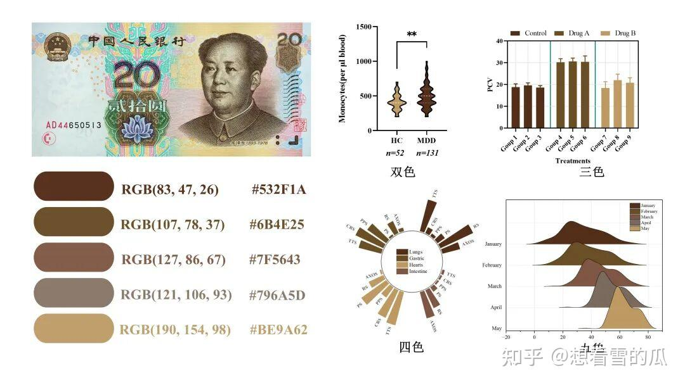
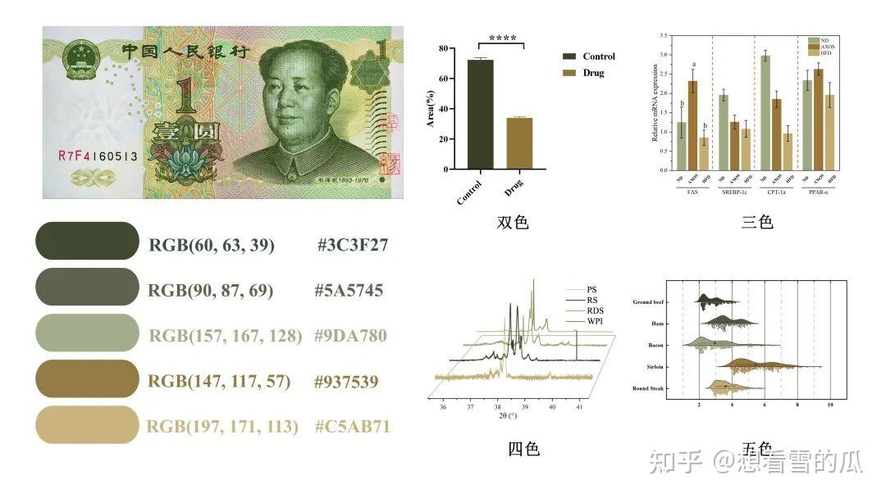

科研绘图不只是把数据画出来，而是用视觉去表达数据。在一篇论文当中，如果配色稳定、有层次，即使图很简单，也会显得很专业，而且还会吸引到审稿专家的注意。

有很多人不知道怎么去找配色，其实最受欢迎的配色就在我们身边——人民币配色。这个已经被验证过的成熟配色体系，用到 SCI 图形中，也会有很好的效果。

> 前半部分的文字与六张色卡图转载自知乎专栏《用人民币配色画图，竟然是顶刊配色！》，作者「想看雪的瓜」，原文见文末，版权归原作者。色值表与后半部分（红绿色弱下的选色计算）是本文补的。

## 六个色系

每个面额对应一套五级色卡，配了「双色／三色／四色／五色」四组示例。

### 100 元（红色系）

### 50 元（绿色系）

### 20 元（棕色系）

### 10 元（蓝色系）

### 5 元（紫色系）

### 1 元（浅绿色系）

## 用法与色值

每张色卡都配了双色、三色、四色、五色四组示例，指向同一条规矩：**一张图在同一色系里取 2～5 级明度**，不是在不同色相里各抓一个颜色；颜色顺序与系列顺序一致。

色值由深到浅，可直接填进 Origin 或 matplotlib：

| 面额 | 1（最深） | 2 | 3 | 4 | 5（最浅） |
|---|---|---|---|---|---|
| 100 元 红 | `#780018` | `#AA0033` | `#DD0022` | `#CC0044` | `#FA8095` |
| 50 元 绿 | `#25362B` | `#276E3D` | `#56B76A` | `#3C4061` | `#8E8E99` |
| 20 元 棕 | `#532F1A` | `#6B4E25` | `#7F5643` | `#796A5D` | `#BE9A62` |
| 10 元 蓝 | `#242F4D` | `#465A66` | `#6382AA` | `#828E99` | `#7F606D` |
| 5 元 紫 | `#413A4C` | `#63576F` | `#6C6E83` | `#6F8DB1` | `#B3A479` |
| 1 元 浅绿 | `#3C3F27` | `#5A5745` | `#9DA780` | `#937539` | `#C5AB71` |

柱子配黑色描边，黑白打印也能分清。

## 评分标准

三个量：把色值转到线性 RGB，乘 Viénot 1999 的二色视矩阵模拟绿色盲，再转 CIE Lab 求两色 ΔE76（≥10 明显可分、5～10 勉强、<5 基本同色）；另取相对亮度 Y 看明度。

两条门槛加一条排序：所选四级必须明度单调（颜色深浅要能读出顺序），模拟后最小 ΔE≥10（要能分辨），两条都过的按 ΔE 从高到低排。

## 六套色卡的得分

在每套里穷举四级组合，先筛掉明度不单调的，再取 ΔE 最大的：

| 色系 | 可用四级 | 各级相对亮度 | 最小 ΔE | 判定 |
|---|---|---|---|---|
| 10 元 蓝 | 1、2、3、4 | 0.029 / 0.096 / 0.215 / 0.264 | 19.9 | 第 1 |
| 5 元 紫 | 1、3、4、5 | 0.047 / 0.160 / 0.256 / 0.375 | 15.8 | 第 2 |
| 20 元 棕 | 1、2、4、5 | 0.039 / 0.087 / 0.152 / 0.349 | 13.6 | 第 3 |
| 100 元 红 | 1、2、3、5 | 0.041 / 0.088 / 0.155 / 0.379 | 12.6 | 第 4 |
| 1 元 浅绿 | 1、2、3、5 | 0.047 / 0.094 / 0.364 / 0.422 | 11.5 | 第 5 |
| 50 元 绿 | 无 | — | — | 淘汰 |

50 元绿淘汰的原因在门槛一：它第 3 级亮绿（0.37）比第 4 级深藏青（0.06）亮，四级里含这两级就逆序，穷举五种组合全部不可读。

## 结论

默认 10 元蓝，四系列取第 1、2、3、4 级：`#242F4D` `#465A66` `#6382AA` `#828E99`——两条门槛都过，分数最高，蓝色又落在红绿色弱保留的蓝—黄轴上。

> 原文地址：https://zhuanlan.zhihu.com/p/2023895130940155098

标准写在前、结论放在后，换一批色卡也能照着算一遍。
