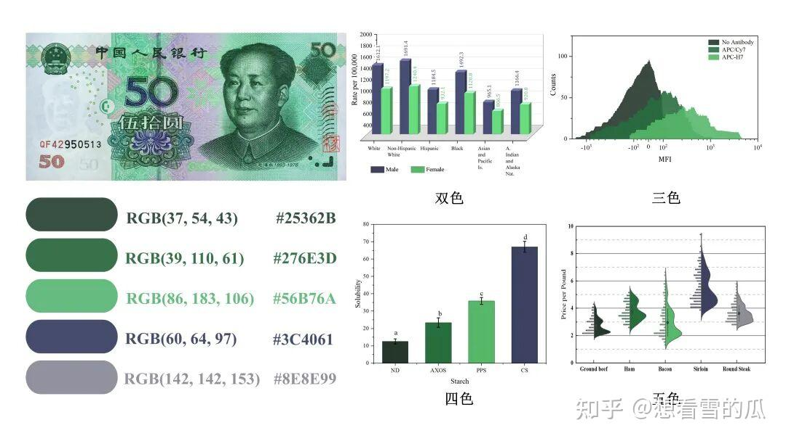
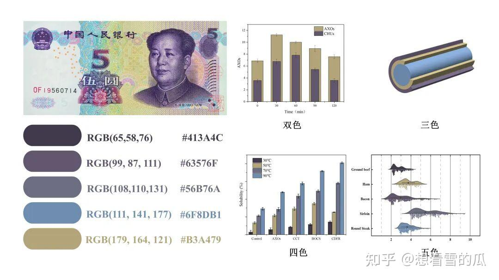

科研绘图不只是把数据画出来，而是用视觉去表达数据。在一篇论文当中，如果配色稳定、有层次，即使图很简单，也会显得很专业，而且还会吸引到审稿专家的注意。

有很多人不知道怎么去找配色，其实最受欢迎的配色就在我们身边——人民币配色。这个已经被验证过的成熟配色体系，用到 SCI 图形中，也会有很好的效果。本文分享一套适合科研作图的核心配色，六个面额对应六套色系，每套五级明度。

> 本文转载自知乎专栏《用人民币配色画图，竟然是顶刊配色！》，作者「想看雪的瓜」，原文见文末。图片与文字版权归原作者，此处仅作学习记录；文末的色值表为转载时按配图逐级整理。

## 100 元（红色系）

## 50 元（绿色系）

## 20 元（棕色系）

## 10 元（蓝色系）

## 5 元（紫色系）

## 1 元（浅绿色系）

## 用法：一张图只用一个色系

素材里每张色卡都配了「双色／三色／四色／五色」四组示例，指向的其实是同一条规矩：**一张图在同一色系里取 2～5 级明度**，而不是在不同色相里各抓一个颜色。系列数少就取两端，系列数多就取中间，颜色顺序与系列顺序（小到大、对照组到处理组）保持一致。

## 色值整理

按配图逐级抄录，由深到浅，便于直接填进 Origin 或 matplotlib：

| 面额 | 1（最深） | 2 | 3 | 4 | 5（最浅） |
|---|---|---|---|---|---|
| 100 元 红 | `#780018` | `#AA0033` | `#DD0022` | `#CC0044` | `#FA8095` |
| 50 元 绿 | `#25362B` | `#276E3D` | `#56B76A` | `#3C4061` | `#8E8E99` |
| 20 元 棕 | `#532F1A` | `#6B4E25` | `#7F5643` | `#796A5D` | `#BE9A62` |
| 10 元 蓝 | `#242F4D` | `#465A66` | `#6382AA` | `#828E99` | `#7F606D` |
| 5 元 紫 | `#413A4C` | `#63576F` | `#6C6E83` | `#6F8DB1` | `#B3A479` |
| 1 元 浅绿 | `#3C3F27` | `#5A5745` | `#9DA780` | `#937539` | `#C5AB71` |

取级建议：2 个系列取第 1、5 级；3 个取 1、3、5；4 个取 1、2、3、5；5 个全取。柱子配黑色描边，黑白打印也能分清。

> 一处原始标注有误：5 元紫第 3 级，图上写的十六进制是 `#56B76A`（那是 50 元绿的值），与同一行的 RGB(108,110,131) 冲突，上表按 RGB 值改正为 `#6C6E83`。

配色这件事，与其每次开图前翻半小时色板，不如把一套已经调好的色卡存进模板里。

> 原文地址：https://zhuanlan.zhihu.com/p/2023895130940155098

转载只为留档：下次画图直接用，不必再翻收藏夹。
