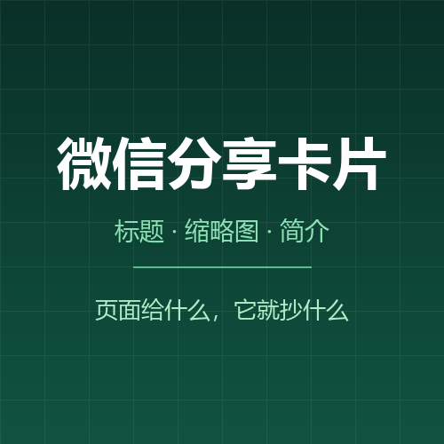

把博客链接发到微信，卡片上那行字和左边那张小图，很多人以为是微信随手挑的。其实是它打开页面，读了几样现成的东西拼出来的。所谓「优化分享卡片」，说到底只有一件事：微信要什么，页面就给什么。

## 它读三样

微信打开链接的时候读三样：页面标题（`<title>`）、页面里的一张图、页面写的简介（`meta description`）。标题直接进卡片，图做缩略图，简介在聊天里显示一行。发朋友圈时只显示标题和缩略图，简介不出现。

它不执行你的程序，也不问你要不要自定义。页面上有什么标记，它抄什么。

## 标题：别让脚本在背后改它

我博客的页脚原来有段小脚本，切走标签页就把标题改成一句玩笑话，切回来再恢复。人看着有趣，微信却会中招：链接打开后页面转到后台，标题正好被改掉，微信抄到的就是那句玩笑，卡片上于是出现一行莫名其妙的字。

所以第一件事是把那段脚本删掉。微信抄的是运行时那一刻的标题，不是你写在模板里的那行。页面上任何在后台改标题的动作，都会原样跑到分享卡片上。

标题还有个小毛病：模板习惯拼成「文章名 | 站名」，分享出去也带着站名。文章页改成只用文章名，列表页和首页保留站名，卡片就干净了。

## 缩略图：给它一张明确的

不指定的时候，微信抓页面里第一张够大的图片。我那篇 LabVIEW 文章第一张图是个软件截图，卡片上就是那张截图，能用，但不像样。

做法是给文章配一张封面，再在页面头里写 `og:image` 指向它，等于在门口挂一张指定的海报，微信优先取这张。这张就是那篇文章的封面：

`og:image` 不是微信专有的标记，Telegram、Slack 这些也读它，一处写好，多处受益。

## 简介：朋友圈看不到，聊天里看得到

简介取 `meta description`，也就是文章摘要那一段。发朋友圈时它不显示；私聊或群里发链接，卡片下面会多出这一行。所以写摘要的时候就得当它会被摆到人眼前，别写成「点击阅读更多」这种话。

## 什么时候才需要 JS-SDK

上面这套是「微信来抓」：免费，不需要资质，不需要后台，缺点是只能引导不能强制。它今天认 `og:image`，改天也可能改规则去抓正文第一张图，你没法命令它。

如果要把标题、缩略图、链接完全钉死，甚至拿到「分享成功」的回调，就得反过来「把内容递给微信」：页面调 JS-SDK 的 `updateAppMessageShareData`，主动告诉微信用哪个标题、哪张图。这条路门槛不低，三个条件缺一不可：公众号已认证，分享接口才有权限；页面所在域名已备案并配进 JS 接口安全域名；服务端能算出签名。静态博客挂在 GitHub Pages 上，域名这一关就过不去。

对个人博客来说，把页面上那三样摆好，比接 JS-SDK 划算得多。

## 两件常被混在一起的事

一件是链接能不能打开。域名被微信拦了要走申诉，申诉通过只解决「门能不能进」。

另一件是打开之后显示什么，也就是上面这些标记。两件事互不相干：门开了，卡片长什么样仍然由页面自己决定。

那篇文章末尾我加了个「发到微信」按钮，它只负责把链接递出去；卡片上的字和图，还是靠这三样标记。

微信要标题、图、简介，页面就把这三样写清楚，别在背后偷偷改标题。
